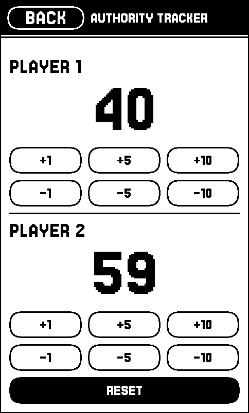

# Authority Tracker

A score tracker for two players, for deck-building and card games where each player's authority (life) counts down to zero.

## Screenshot

Drawn on a PC by `tools/preview/screenshots.sh`, with the same pixels the panel shows.

## Rules

- Both players start at 50. That's only the starting number: a score can go up past 50, as high as 999.
- A score never goes below 0. When one reaches 0 the game is over, and the other player's name turns into a `WINS` capsule.

## Getting around

- Each player has six buttons under their score: `+1 +5 +10` on top and `-1 -5 -10` below.
- When the game is over, every button is greyed out except the + buttons of the player at 0. Those take back a mistaken tap, and the game carries on.
- `RESET` sets both scores back to 50. During a game it asks first: it changes to `TAP AGAIN TO RESET`, and any other tap cancels it. After a game ends it resets on one tap. It's greyed out while both scores are at 50.
- `BACK` in the header returns to the home page.

## Saves

All in `/.pocketplay/`:

| Name | Holds |
|---|---|
| `authoritytracker` | Both scores, saved after every tap, so sleep or a flat battery brings back the same game. A finished game stays until you press `RESET`. |

The home-page icon is Lucide's "shield" (ISC licence).
