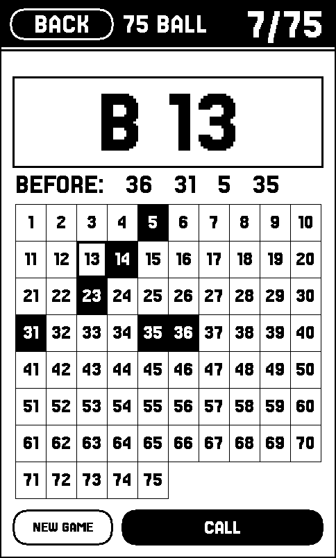

# Bingo Caller

Calls the numbers for a game of bingo played on paper cards: 30, 75, 80 or 90-ball. Each call is drawn at random from the numbers not called yet, and a board shows every number that's out.

## Screenshot

Drawn on a PC by `tools/preview/screenshots.sh`, with the same pixels the panel shows.

## Getting around

- **Choose a game:** tap `30 BALL`, `75 BALL`, `80 BALL` or `90 BALL`. A game with calls in it shows `IN PLAY` and its count. Tap it to carry on.
- **Switching games:** only one game is kept. Choosing a different one while a game has calls asks first: the row says `TAP AGAIN`, and a second tap ends the old game.
- **Calling:** `CALL`, or the Down button, calls the next number. It shows large in the box at the top, with its letter in 75-ball (`B` 1-15, `I` 16-30, `N` 31-45, `G` 46-60, `O` 61-75). The four calls before it are listed under it, newest first.
- **The board:** called numbers turn black. The latest is the white one with the thick frame. The count in the header shows how many are out.
- **The end:** once every number is out, `CALL` greys to `ALL CALLED`.
- **Starting over:** `NEW GAME` starts the same game again. It asks first by changing to `SURE?`, and a tap anywhere else takes that back.
- **Leaving:** `BACK` goes to the list of games, and `BACK` there returns to the home page.

## How the calls stay fair

Every call mixes the chip's random number with the exact microsecond of your tap, then picks from the numbers left by rejection sampling, so every number left is exactly equally likely. The PC tests make 300,000 first calls and play 90,000 whole 90-ball games to check that no number and no position is favoured.

## Saves

All in `/.pocketplay/`:

| Name | Holds |
|---|---|
| `bingocaller` | The game in play and every call in order, saved on each call, so sleep or a flat battery carries on where it was. Erased by `NEW GAME` or by starting a different game. |

The icon is Lucide's grid-2x2-check (ISC licence).
