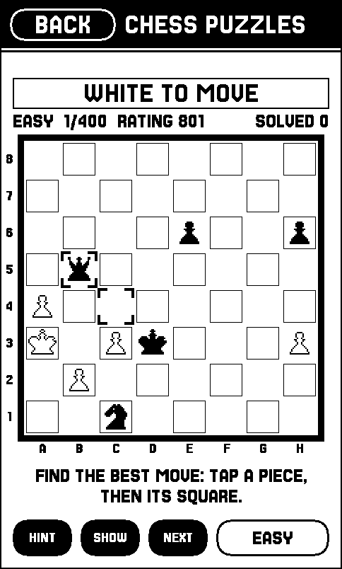

# Chess Puzzles

2398 chess tactics puzzles from the Lichess puzzle database: find the best move, then keep going until the line is over.

## Screenshot

Drawn on a PC by `tools/preview/screenshots.sh`, with the same pixels the panel shows.

## Rules

- The opponent's move that sets the puzzle is made for you, and marked with corners on the squares it left and reached. The board turns so your side is at the bottom.
- Find the best move. A right move gets the opponent's reply at once, and you play on until the line ends. A wrong move is counted, and you try again.
- Castling, en passant and promotion are all played as in chess. To castle, move the king two squares.

**Banks**, about 400 puzzles each, easiest first:

| Bank | Puzzles |
|---|---|
| `MATE IN 1` | Checkmate in one move |
| `MATE IN 2` | Checkmate in two moves |
| `EASY` | Rated 800 to 1200 |
| `MEDIUM` | Rated 1200 to 1600 |
| `HARD` | Rated 1600 to 2000 |
| `EXPERT` | Rated 2000 to 2400 |

Only well-tried puzzles are in the banks: each was played at least 1000 times and liked by at least 90% of players.

## Getting around

- Tap one of your pieces to pick it up, and it's framed. Then tap the square to move it to. Tap the framed piece again, or anywhere off the board, to put it down. Tap another of your pieces to pick that one up instead.
- White pieces are outlines and black ones solid. Dark squares have an inner frame.
- The capsule says whose move it is. The line under it shows the bank, the puzzle's number and rating, and how many puzzles you've solved in this bank.
- `HINT` frames the piece to move with a double frame. A second `HINT` frames its square too.
- `SHOW` makes the move for you.
- Once the line is over, the capsule turns black with `SOLVED!`. The line under the board says how it went (`FIRST TRY`, how many wrong moves, or `WITH HELP` if you used `SHOW`) and the puzzle's themes, such as `FORK` or `BACK RANK MATE`. A hint doesn't stop a solve counting as first try.
- `NEXT`, or the Down button, goes to the next puzzle, and goes back to the first after the last. The Up button goes to the one before.
- The last button names your bank. Tap it for the list of banks, with your place and how many you've solved in each, and tap one to play it. A bank opens at the puzzle it was on, from the start. `BACK` returns to the board.
- `BACK` in the header returns to the home page. The puzzle is kept, so you can finish it later.

## Saves

`chesspuzzles` in `/.pocketplay/` holds your bank, your place in every bank, how many you've solved in each (and how many first try), and how far into the open puzzle you are, with its wrong moves. It's written after every move, so sleep or a flat battery brings back the same position.

## Credits

Translated from Omer Faruk Inel's Chess puzzles in touch-licorice-apps, with its puzzles and pieces copied unchanged, and modified for PocketPlay, under the MIT licence (`LICENSE-licorice.txt`). The puzzles are from the [Lichess puzzle database](https://database.lichess.org/#puzzles) (CC0). The icon is Lucide's chess-pawn (ISC licence).
