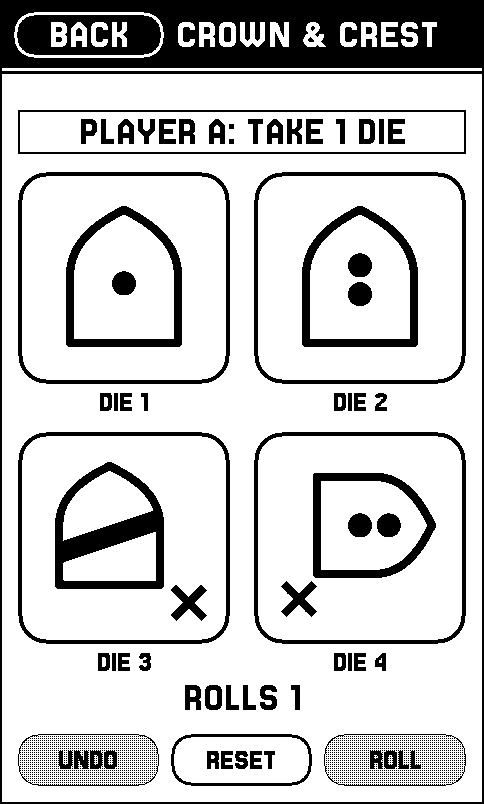

# Crown & Crest

The four dice for Crown & Crest, a game for two players, A and B. Each die has its own six faces: shields with stripes, dots or quarters, some with X marks beside them, and a `?` on dice 3 and 4.

## Screenshot

Drawn on a PC by `tools/preview/screenshots.sh`, with the same pixels the panel shows.

## A turn

1. The roller rolls all four dice. Player A rolls first.
2. The roller takes one die.
3. The other player takes two of the three left.
4. The roller gets the last die.

Then the other player rolls, and the same happens with the roles swapped. Scoring and the number of rounds stay off the device for now.

## Getting around

- `A ROLLS` or `B ROLLS` names whose roll is next. Tap it, or press the Down button, to roll all four dice. It greys out to `ROLL` while dice are still to be taken.
- The capsule at the top says whose move it is, such as `PLAYER B: TAKE 2 DICE`.
- Tap a die (or its label) to take it for the player named in the capsule. A taken die's label turns black and names its owner, such as `DIE 3: PLAYER A`.
- Once all four are shared out, the capsule turns black and says who rolls next.
- `UNDO` takes back the last die taken this turn.
- `ROLLS` under the dice counts every roll by either player since the game began. It stops at 99999.
- `RESET` starts a new game: the dice go blank, the count goes back to 0, and player A rolls first. It turns into `SURE?` on the first tap, and only a second tap on it resets. Any other tap, or the Down button, cancels it. It's greyed out before the first roll.
- `BACK` in the header returns to the home page. The turn is kept.

## How the dice stay fair

Every roll mixes the chip's random number with the exact microsecond of your tap, then picks each face by rejection sampling, so all six faces of every die are exactly equally likely. The PC tests roll 600,000 times and check each die's faces, and that the dice don't follow each other.

## Saves

All in `/.pocketplay/`:

| Name | Holds |
|---|---|
| `crowncrest` | The dice showing, who rolled them, the dice taken so far and the roll count, saved on every roll and pick, so sleep or a flat battery brings back the same turn. `RESET` erases it. |

## Credits

Inspired by Bruno Cathala and Ludovic Maublanc's [Kingdomino Duel](https://boardgamegeek.com/boardgame/281960/kingdomino-duel). The dice faces are original line art, drawn by [`tools/crowncrest_faces.py`](../../../tools/crowncrest_faces.py). The icon is Lucide's shield (ISC licence).
