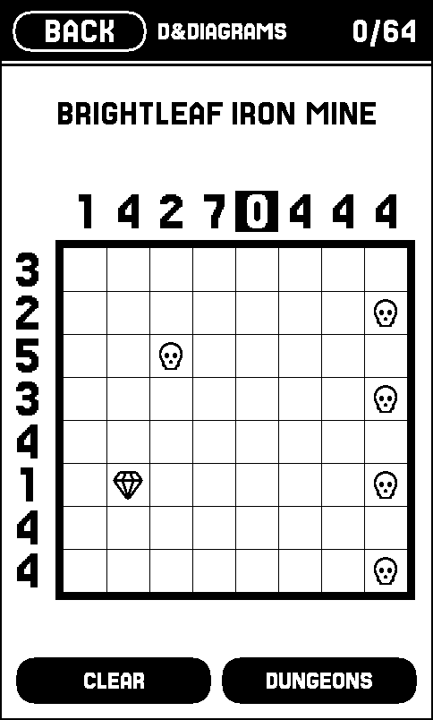

# D&Diagrams

A logic puzzle where you uncover a hidden dungeon by placing walls. There are 64 dungeons in eight tiers of eight, plus a tutorial, and each one has exactly one answer.

## Screenshot

Drawn on a PC by `tools/preview/screenshots.sh`, with the same pixels the panel shows.

## Rules

Each grid hides a dungeon. You place walls; every square without a wall is floor. A solved dungeon follows all of these:

1. **The numbers:** the number beside each row and above each column is how many walls it holds.
2. **Monsters:** every dead end (a floor square with only one open neighbour) holds a monster, and every monster sits in a dead end.
3. **Treasure:** every chest sits in a 3x3 room of floor with exactly one way in, one chest and no monsters.
4. **Corridors:** corridors are one square wide. Outside treasure rooms, there are no 2x2 blocks of floor.
5. **The map:** all the floor joins up into one area. Squares that touch only at a corner aren't joined.

You can solve every dungeon with logic alone; no guessing is needed.

## Getting around

- **Menu:** the campaign map, with the chosen dungeon's name above it. Tap a room to choose it (brackets show the choice), or step through the rooms with the Up and Down buttons (Up goes left, Down goes right, and both wrap around from 64 to 1), then `PLAY` to open it, or `RESUME` if you've already marked it. A cleared dungeon is a filled room, and a tier's number fills once all eight of its dungeons are cleared. `TUTORIAL` opens the guide.
- **Board:** tap a square to place a wall, tap again to mark it as floor (a note for yourself), and once more to clear it. Monsters and chests can't be marked. A clue turns black when its row or column has exactly the right number of walls, and grey when it has too many. `CLEAR` empties the board, and `DUNGEONS` goes back to the map.
- **Guide:** eight pages, one rule each, shown on the tutorial's board a step further along each time. `NEXT` and `PREV` turn the pages, and `PLAY` on the last page opens the map.
- **Win:** the dungeon's name and its finished map. `NEXT` opens the next dungeon you haven't solved. Once all of them are solved, `NEXT` opens dungeon 64 again.
- `BACK` in the header steps back a page in the guide, returns to the map from the board or win screen, and returns to the home page from the map.

## Saves

`dungeon` holds the dungeon you're on, its walls and floor notes, and which dungeons you've solved. It's written on every mark and never erased, because it holds your campaign.

## Credits

Copied from CrossPlay and modified for PocketPlay, under the MIT licence (`LICENSE-CrossPlay.txt`). The icon is from Lucide (ISC licence).
