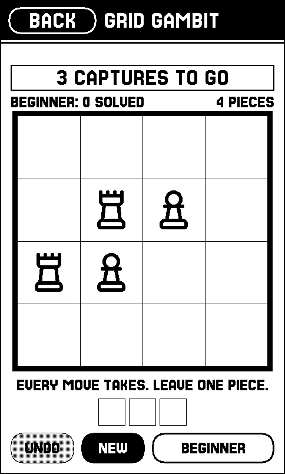

# Grid Gambit

A chess puzzle for one player on a 4x4 board: every move must take a piece, and you win when only one is left. Puzzles are made on the device, so they never run out, and each one can be solved.

## Screenshot

Drawn on a PC by `tools/preview/screenshots.sh`, with the same pixels the panel shows.

## Rules

- Every move is a capture: one piece takes another, landing on its square. A piece can never move to an empty square.
- Pieces move as in chess:
  - **King:** one square in any direction.
  - **Queen:** any distance along a row, column or diagonal.
  - **Rook:** any distance along a row or column.
  - **Bishop:** any distance along a diagonal.
  - **Knight:** an L, two squares one way and one the other, jumping over anything between.
  - **Pawn:** one square diagonally up the board. It can't take straight ahead, sideways or downwards, so a pawn on the top row is stuck.
- The queen, rook and bishop stop at the first piece in their way, which they may take.
- There's no check and no promotion, and the king can be taken like any other piece.
- The puzzle is solved when one piece is left. If more than one is left and nothing can take, the puzzle is lost.

**Levels:**

| Level | Pieces |
|---|---|
| `BEGINNER` | 4 |
| `INTERMEDIATE` | 5 or 6 |
| `ADVANCED` | 6 or 7 |
| `EXPERT` | 8 |

A puzzle is made by playing the game backwards from one piece. Each level also wants puzzles where taking pieces at random rarely wins: the higher the level, the fewer ways there are to stumble on the answer.

## Getting around

- Tap a piece to pick it up. It's framed, and the pieces it can take are bracketed. Tap a bracketed piece to take it.
- Tap the framed piece again, an empty square or anywhere off the board to put it down. Tapping another piece that can take picks that one up instead. A piece with nothing to take says `THAT PIECE CAN'T TAKE ANYTHING.`
- The capsule shows how many captures are left. The line under it shows the level, how many puzzles you've solved at that level, and how many pieces the puzzle started with.
- The row of squares under the board fills with the pieces you've taken, in order, one square for each capture the puzzle needs.
- When the puzzle ends, the capsule turns black and says `SOLVED!` or `NO CAPTURES LEFT`.
- `UNDO` takes back your last capture, as far back as the start, even after the puzzle has ended.
- `NEW` makes another puzzle at the same level.
- The third button names your level. Tap it to move to the next level (after `EXPERT` comes `BEGINNER`), which makes a new puzzle.
- A puzzle takes a moment to make. The board says `MAKING A PUZZLE` until it's ready, usually under a second, and longer at `EXPERT`.
- `BACK` in the header returns to the home page. The puzzle is kept, so you can finish it later.

## Saves

`gridgambit` in `/.pocketplay/` holds your level, the puzzle, every capture you've made, and how many puzzles you've solved at each level. It's written after every capture, so sleep or a flat battery brings back the same position, with undo. A solved puzzle counts once, even if you undo and solve it again. When you come back to a solved puzzle, the next one is made instead. A lost one is kept, so you can undo.

## Credits

An original game for PocketPlay, after the 4x4 capture-only chess puzzles. The pieces and the icon are Lucide's chess icons (ISC licence).
