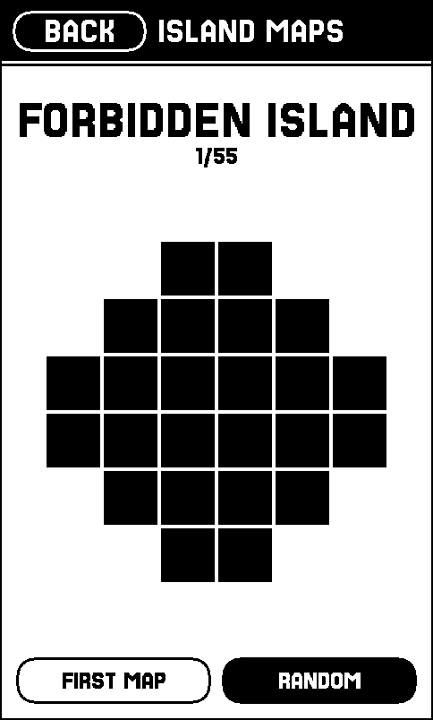

# Island Maps

55 island layouts for laying out the tiles of the Forbidden Island board game: the official islands and fan-made ones. Each island is drawn with its tiles in black, so you can lay out the real tiles to match.

## Screenshot

Drawn on a PC by `tools/preview/screenshots.sh`, with the same pixels the panel shows.

## Getting around

- **Browsing:** Up and Down step through the islands one at a time, and wrap round past the first and the last. The number under the name is the island's place in the list.
- **The first island:** `FIRST MAP` goes back to Forbidden Island, the first in the list, so you can step through the rest in order from there.
- **A random island:** `RANDOM` jumps to any island but the one on screen, each equally likely.
- **The order:** the 11 official islands come first, starting with Forbidden Island, then the fan-made ones from A to Z.
- **Leaving:** `BACK` returns to the home page. The game opens again on the island you left it on.

Most islands use 24 tiles, as the game has. Four don't in the collection they come from, and are drawn as it has them: Coral Reef and Palm Springs have 25, Hangman's Harbour has 26, and Serpent Shoals has 22.

## Saves

All in `/.pocketplay/`:

| Name | Holds |
|---|---|
| `islandmaps` | The island on screen, saved each time it changes. |

## Credits

Forbidden Island and its official islands are by Matt Leacock. The fan-made islands are by Brichs, gwommy, newuser, Go_Petunias, wynnr67, ianoble, Blott, Keeple and Atrox7, and others not named in the collection. Three islands the collection leaves unnamed are called Ladder Cay, Serpent Shoals and Spyglass Isle here. The icon is Lucide's map (ISC licence).
