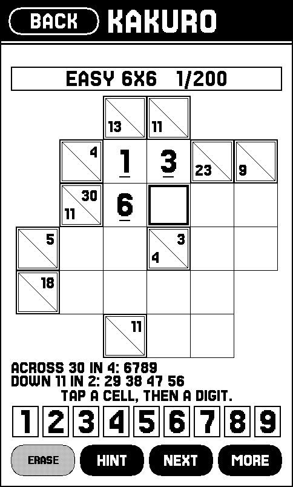

# Kakuro

Cross sums: fill the white cells with digits 1 to 9 so that each run of white cells, across or down, adds up to the clue at its start, with no digit twice in a run. There are 600 puzzles in three levels, and each has one solution you can reach by reasoning about the runs.

## Screenshot

Drawn on a PC by `tools/preview/screenshots.sh`, with the same pixels the panel shows.

## Rules

- A clue cell has a diagonal. The number in its top right is the sum of the run to its right, and the number in its bottom left is the sum of the run below it.
- A run's digits are all different. 16 in 2 can only be 7 and 9; 4 in 2 only 1 and 3.
- The puzzle is solved when every white cell holds the right digit.

**Levels:**

| Level | Board | Puzzles |
|---|---|---|
| `EASY 6X6` | 6 by 6, with 5 by 5 to fill | 200 |
| `MEDIUM 7X7` | 7 by 7 | 200 |
| `HARD 8X8` | 8 by 8 | 200 |

## Getting around

- Tap a white cell to select it, then a digit on the keys. `ERASE` clears it.
- Under the board are the selected cell's two runs and every way to make them, such as `ACROSS 16 IN 2: 79`. When there are too many to fit, the line gives how many ways there are.
- A digit repeated in a run, or a run that adds up wrong, gets a small cross.
- `HINT` fills the selected cell if it's empty or wrong, or else the first such cell. A digit from a hint is underlined and can't be changed.
- `NEXT`, or the Down button, goes to the next puzzle, and the Up button to the one before. Both wrap round at the ends. Only the puzzle on screen keeps its digits, so moving away from one starts it fresh.
- `MORE` lists the three levels with how many of each you've solved; tap one to play it, at the puzzle you were on there. It also has `PREVIOUS`, `START OVER` and `HOW TO PLAY`.
- Once solved, the capsule turns black and the board stays as it is: `NEXT` for another.
- Clue cells have a double border rather than being black, since big black areas ghost on this screen. A grey block is an empty one inside the board, not a cell to fill.
- `BACK` returns to the board from a page, or to the home page from the board.

## Saves

All in `/.pocketplay/`:

| Name | Holds |
|---|---|
| `kakuro` | The level you're on, your place in every level, which puzzles you've solved, and the digits on the board with which came from hints. Written on every change, so sleep or a flat battery brings back the same board. |

## Credits

Translated from Omer Faruk Inel's Kakuro in touch-licorice-apps, with its puzzles copied unchanged, and modified for PocketPlay, under the MIT licence (`LICENSE-licorice.txt`).
