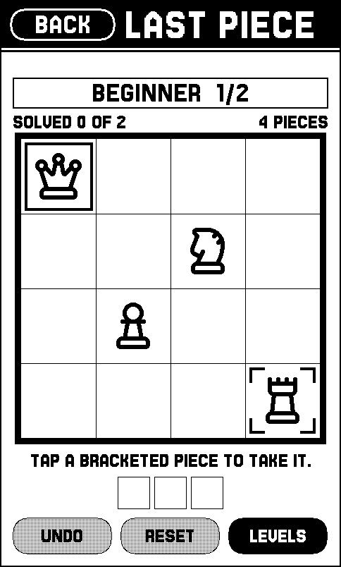

# Last Piece

Numbered chess challenges for one player on a 4x4 board: every move must take a piece, and you win when only one is left. The challenges are text files you copy onto the card, in four difficulties: `BEGINNER`, `INTERMEDIATE`, `ADVANCED` and `EXPERT`.

## Screenshot



Drawn on a PC by `tools/preview/screenshots.sh`, with the same pixels the panel shows.

## Rules

- Every move is a capture: one piece takes another, landing on its square. A piece can never move to an empty square.
- Pieces move as in chess:
  - **King:** one square in any direction.
  - **Queen:** any distance along a row, column or diagonal.
  - **Rook:** any distance along a row or column.
  - **Bishop:** any distance along a diagonal.
  - **Knight:** an L, two squares one way and one the other, jumping over anything between.
  - **Pawn:** one square diagonally up the board. It can't take straight ahead, sideways or downwards, so a pawn on the top row is stuck.
- The queen, rook and bishop stop at the first piece in their way, which they may take.
- There's no check and no promotion, and the king can be taken like any other piece.
- The challenge is solved when one piece is left. If more than one is left and nothing can take, it's lost.

## Putting challenges on the card

The game reads the folder `/lastpiece` on the card, and makes it the first time it opens. Each difficulty is one file, so put in only the ones you have:

| File | Holds |
|---|---|
| `beginner.txt`, `intermediate.txt`, `advanced.txt`, `expert.txt` | The challenges |
| `beginner-solutions.txt` and so on | Their solutions. Optional: each is checked against its board, so you know the challenge plays as written. |

A challenge is 4 lines of 4 cells, top row first, with a blank line after it. A cell is `P` (pawn), `N` (knight), `B` (bishop), `R` (rook), `Q` (queen), `K` (king), or `.` for an empty square, in capitals or not. Spaces between cells are optional, and a line starting with `#` is a comment:

```
# 1
Q . . .
. . N .
. P . .
. . . R
```

Challenges are numbered 1, 2, … in the file's order. A board needs 2 to 10 pieces, and one that can't be solved is left out.

A solutions file has one line per challenge: its number, a colon, then each capture as the row and column it leaves and the row and column it takes, with row 0 at the top and column 0 on the left:

```
01: 0,0->3,3 1,2->3,3 3,3->2,1
```

[example.txt](example.txt) and [example-solutions.txt](example-solutions.txt) in this folder hold two challenges to start from. Copy them to the card as `beginner.txt` and `beginner-solutions.txt`.

Each file can be up to 16 KB and hold up to 99 challenges. The game reads the files whenever it opens and whenever you open `LEVELS`, so you can change them on a computer without restarting. `LEVELS` lists anything it couldn't use, such as `BEGINNER: 1 CHALLENGE SKIPPED. 2 SOLUTIONS DROPPED.` A challenge is skipped for a cell it can't read, a row without 4 cells, too few or too many pieces, or no way to win. A solution is dropped if it doesn't read, a move isn't a capture, it doesn't end on one piece, or no challenge has its number.

## Getting around

- Tap a piece to pick it up. It's framed, and the pieces it can take are bracketed. Tap a bracketed piece to take it.
- Tap the framed piece again, an empty square or anywhere off the board to put it down. A piece with nothing to take says `THAT PIECE CAN'T TAKE ANYTHING.`
- The capsule shows the difficulty and the challenge, such as `BEGINNER  3/20`. The line under it shows how many you've solved at that difficulty, and how many pieces this one starts with, or `SOLVED BEFORE`.
- The row of squares under the board fills with the pieces you've taken, in order, one square for each capture the challenge needs.
- When a challenge ends, the capsule turns black and says `SOLVED!` or `NO CAPTURES LEFT`.
- `UNDO` takes back your last capture, as far back as the start, even after the challenge has ended.
- `RESET` puts every piece back where the challenge started. Your solved mark stays.
- The Up and Down buttons go to the previous and next challenge at the same difficulty, wrapping at the ends. A challenge you leave part-way starts again when you come back.
- `LEVELS` lists the four difficulties with how many of each you've solved. Tap one to play it, at the challenge you were on there. A difficulty with no file is dimmed. `BACK` returns to the board.
- `BACK` in the header returns to the home page. The challenge is kept, so you can finish it later.

## Saves

`lastpiece` in `/.pocketplay/` holds your difficulty, the challenge you're on at each, which challenges you've solved, and every capture on the board. It's written after every capture, so sleep or a flat battery brings back the same position, with undo. If you change the challenge's board in its file, the position starts again. Solved marks go by each challenge's place in the list, so they stay with the right challenges as long as you add new ones at the end and fix any that are skipped.

## Credits

An original game for PocketPlay, after the 4x4 capture-only chess puzzles, with Grid Gambit's rules. The pieces and the icon are Lucide's chess icons (ISC licence).
