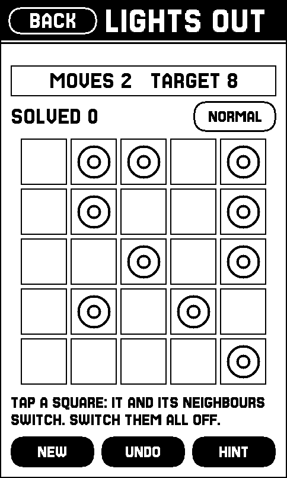

# Lights Out

A 5x5 board of lights. Switch them all off.

## Screenshot

Drawn on a PC by `tools/preview/screenshots.sh`, with the same pixels the panel shows.

## Rules

- Tapping a square switches it and its four neighbours, on to off and off to on.
- Every puzzle can be solved. The **target** is the fewest presses that clear it, shown as `MOVES 3   TARGET 6`.
- Clear the board to win. You'll see `SOLVED IN 6 - FEWEST!` if you matched the target, or `SOLVED IN 9 - BEST IS 6` if not.

## Getting around

- `HINT` frames one square of a fewest-press solution from where you are.
- `UNDO` takes back your last press.
- `NEW` starts a new puzzle.
- The level button beside the record steps through `EASY`, `NORMAL` and `HARD`, with targets of at least 3, 6 and 10. It applies from the next `NEW`.
- After a win, `UNDO` and `HINT` dim, and `NEW` gives the next puzzle.
- `BACK` in the header returns to the home page. The puzzle is kept, so you can finish it later.

## Saves

All in `/.pocketplay/`:

| Name | Holds |
|---|---|
| `lightsout` | The puzzle in play, with your moves and undo history. Written on every press, and erased when the puzzle is solved. |
| `lightsout-stats` | How many puzzles you've solved, and the level you chose. |

## Credits

Translated from Omer Faruk Inel's Lights Out in touch-licorice-apps and modified for PocketPlay, under the MIT licence (`LICENSE-licorice.txt`).
