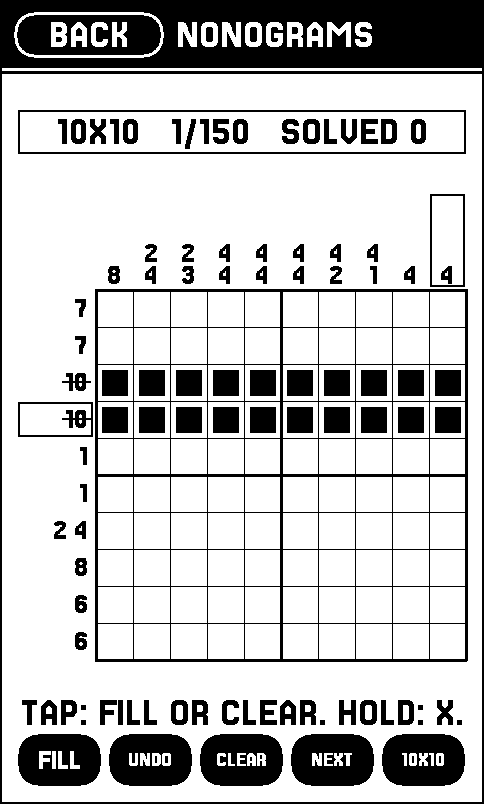

# Nonograms

Picture logic puzzles: fill the cells so that every row and column shows its clue, the lengths of its runs of filled cells in order. There are 600 puzzles, 150 in each of four sizes, and each can be solved line by line without guessing, so it has one answer.

## Screenshot

Drawn on a PC by `tools/preview/screenshots.sh`, with the same pixels the panel shows.

## Rules

- A clue such as `2 4` means that line has a run of 2 filled cells, then a run of 4, with at least one empty cell between them and any number either side.
- The puzzle is solved when the filled cells are the picture. X marks are only notes: they count as empty.

**Sizes:** `5X5`, `8X8`, `10X10` and `12X12`. Bigger boards would make the cells too small to tap.

## Getting around

- Tap a cell to fill it, and tap it again to clear it.
- **Hold** a cell for a moment to mark it X, for a cell you know is empty; hold again to clear it. The cell is outlined while the hold builds.
- `FILL` switches to `X`, so plain taps mark X instead.
- The clues of the row and column you last tapped are framed. A line whose filled cells match its clue has its clue struck through. Every fifth grid line is thicker, to help counting.
- `UNDO` takes back your last tap on this puzzle.
- `CLEAR` empties the board, after asking.
- `NEXT`, or the Down button, goes to the next puzzle, and the Up button to the one before. Both wrap round at the ends.
- The size button (`10X10`) lists the four sizes with how many of each you've solved. Each size remembers the puzzle you were on.
- Once solved, the capsule turns black and the board stays as it is: `NEXT` for another, or `CLEAR` to play it again.
- `BACK` returns to the board from a page, or to the home page from the board.

## Saves

All in `/.pocketplay/`:

| Name | Holds |
|---|---|
| `nonograms` | The size you're on, your place in every size, `FILL` or `X`, and which puzzles you've solved. |
| `nonograms-grids` | The cells of puzzles left half done, the newest 40 in each size, so you can come back to them. |

Both are written on every tap, so sleep or a flat battery brings back the same board. `UNDO` doesn't survive leaving a puzzle.

## Credits

Translated from Omer Faruk Inel's Nonograms in touch-licorice-apps, with its puzzles copied unchanged, and modified for PocketPlay, under the MIT licence (`LICENSE-licorice.txt`).
