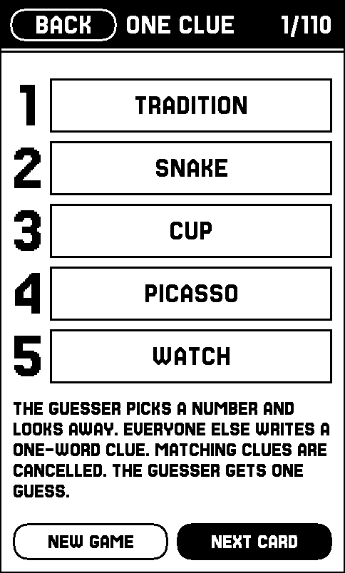

# One Clue

A deck of word cards for a cooperative party game played round a table. PocketPlay only deals the cards. Clues, guesses and the score stay on paper.

## Screenshot

Drawn on a PC by `tools/preview/screenshots.sh`, with the same pixels the panel shows.

## Rules

- The screen shows one card of five numbered words.
- The guesser picks a number without looking at the card.
- Everyone else writes a one-word clue for that word. Clues that match each other are cancelled.
- The guesser then gets one guess from the clues that are left.

## Getting around

- `NEXT CARD`, or the Down button, turns over a card that hasn't been shown since the last shuffle. The band shows how far through the deck you are, such as `12/110`.
- After all 110 cards, `NEXT CARD` dims, and a line says `NEW GAME` reshuffles.
- `NEW GAME` shuffles all 110 cards and shows the first one.
- `BACK` returns to the home page and keeps the deck.

## Saves

`oneclue` holds the shuffled deck and how many cards have been shown. It's written on every `NEXT CARD` and `NEW GAME`, so after a sleep or a flat battery you get the same card back, and cards you've used don't come back until you reshuffle.

## Credits

Plays like the party game Just One, with its own name. Thanks to Just One's designers, Ludovic Roudy and Bruno Sautter, for the game it's played after: [Just One](https://boardgamegeek.com/boardgame/254640/just-one).
