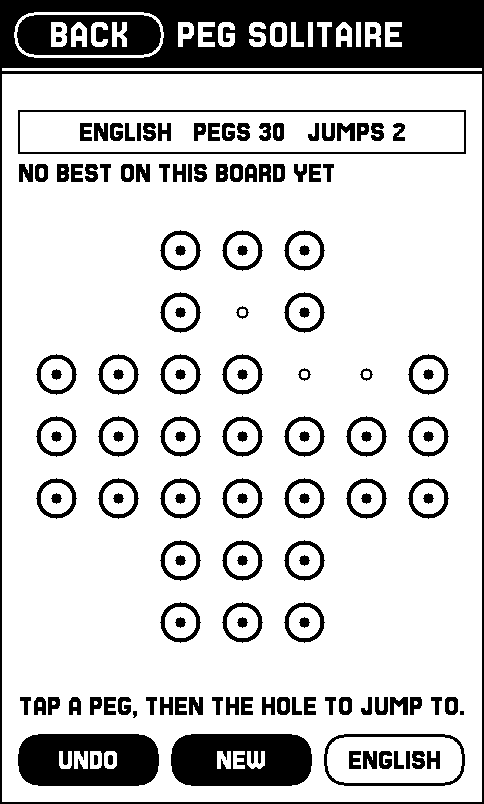

# Peg Solitaire

Jump pegs over each other until as few as possible are left. One peg is a win, and one peg in the centre of the English board is the classic perfect game.

## Screenshot

Drawn on a PC by `tools/preview/screenshots.sh`, with the same pixels the panel shows.

## Rules

- A peg jumps over a neighbouring peg into the empty hole just beyond it, and the peg it jumped over is removed.
- **English:** 33 holes in a cross, with only the centre empty at the start. Pegs jump along rows and columns.
- **Triangle:** 15 holes, with only the top empty at the start. Pegs jump in the triangle's six directions: along a row, and along both diagonals.
- The game ends when no peg can jump. It's rated by how many pegs are left: `PERFECT` for one in the centre of the English board, `EXCELLENT` for one, `VERY GOOD` for two, `GOOD` for three or four, and `TRY AGAIN` for more.

## Getting around

- Tap a peg to pick it up. It's framed, and the holes it can jump to are ringed. Tap a ringed hole to jump.
- Tap the framed peg again, or tap off the board, to put it down. A peg with no jump says `THAT PEG CANNOT JUMP.`
- The capsule shows the board, the pegs left and the jumps made, and the line under it your best on this board.
- When no jump is left, the capsule turns black with the rating.
- `UNDO` takes back your last jump, as far back as the start, even after the game has ended.
- `NEW` starts the board again.
- The third button names the board you're on (`ENGLISH` or `TRIANGLE`). Tap it to switch to the other board, which starts fresh.
- `BACK` in the header returns to the home page. The game is kept, so you can finish it later.

## Saves

`pegsolitaire` in `/.pocketplay/` holds the board you're on, every jump you've made, and your best on each board. It's written after every jump, so sleep or a flat battery brings back the same position, with undo.

## Credits

Translated from Omer Faruk Inel's Peg Solitaire in touch-licorice-apps and modified for PocketPlay, under the MIT licence (`LICENSE-licorice.txt`).
