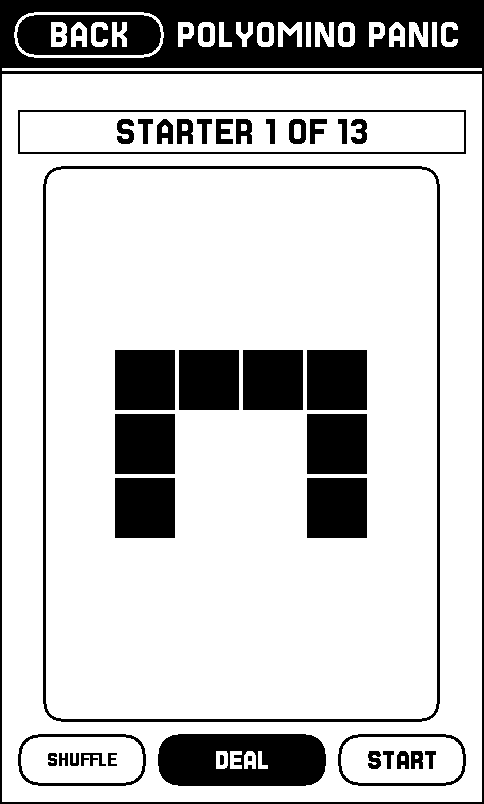

# Polyomino Panic

Holds the two decks for Polyomino Panic, played on paper. Everyone draws their own grid and keeps their own score; the device only deals the cards.

- **Starter deck:** 13 cards, each a shape of 8 squares.
- **Game deck:** 40 cards, shapes of 1 to 7 squares.

Every shape is drawn in solid black. The paper cards' colours aren't shown.

## Screenshot

Drawn on a PC by `tools/preview/screenshots.sh`, with the same pixels the panel shows.

## Getting around

- **Starting shapes:** each tap of `DEAL`, or the Down button, turns over one card from the starter deck. Pass the device round and deal once per player: no shape comes up twice, so everyone starts with a different one. The capsule counts them (`STARTER 2 OF 13`), and once all 13 are out it turns black with `ALL 13 DEALT` and `DEAL` greys out.
- **Shuffling:** `SHUFFLE` puts every starter card back in a new order, for a new set of players.
- **Starting play:** `START` turns over the first two cards of the game deck. You don't have to deal starters first, so a game without them can begin straight away.
- **Rounds:** each round shows two cards, one above the other, and each player plots one of them. `NEXT ROUND`, or the Down button, discards both and turns over the next two. The capsule shows the round (`ROUND 3 OF 20`) and the line under the cards how many are left.
- **The end:** the deck lasts 20 rounds. After the last pair, the capsule turns black with `GAME OVER`, the last pair stays on show, and `NEXT ROUND` greys out. You can stop sooner whenever you like.
- **Starting over:** `NEW GAME` shuffles both decks and goes back to the starter deck. It asks first by changing to `SURE?`, and a tap anywhere else takes that back.
- **Leaving:** `BACK` returns to the home page. The game is kept.

## Saves

All in `/.pocketplay/`:

| Name | Holds |
|---|---|
| `polyominopanic` | Both decks' order and how far into each you are, saved on every deal and round, so sleep or a flat battery brings back the same cards. Erased when the game deck runs out, so the next visit starts a new game. |

## Credits

Inspired by Uwe Rosenberg's [Second Chance](https://boardgamegeek.com/boardgame/265683/second-chance). The icon is Lucide's blocks (ISC licence).
