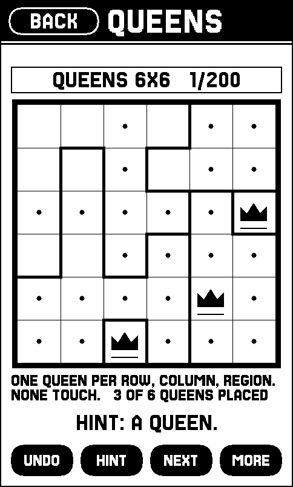

# Queens

A logic puzzle on a grid split into outlined regions, in two forms: **Queens**, with one queen in every row, column and region, and **Star Battle**, with two stars in each. There are 1200 puzzles in six sizes, and each has a single answer you can reach by reasoning, without guessing.

## Screenshot

Drawn on a PC by `tools/preview/screenshots.sh`, with the same pixels the panel shows.

## Rules

- Place one queen (Queens) or two stars (Star Battle) in every row, every column and every region. The regions are the areas inside the thick borders.
- No two pieces may touch, not even diagonally.
- The puzzle is solved when every piece is in place.

**Sizes:**

| Size | Pieces | Puzzles |
|---|---|---|
| `QUEENS 6X6` | 1 a row | 200 |
| `QUEENS 7X7` | 1 a row | 200 |
| `QUEENS 8X8` | 1 a row | 200 |
| `QUEENS 9X9` | 1 a row | 200 |
| `STAR BATTLE 9X9` | 2 a row | 200 |
| `STAR BATTLE 10X10` | 2 a row | 200 |

The bigger the board, the more reasoning each puzzle needs.

## Getting around

- Tap a square once for a **cross** (nothing goes here), again for a **queen** or **star**, and a third time to clear it.
- With dots on, every square your pieces already rule out gets a dot, so it needs no cross: the squares around a piece, and the rest of any row, column or region that's full.
- A piece that breaks a rule is ringed, and the line under the board says which rule, such as `TWO QUEENS TOUCH.` or `TOO MANY STARS IN A ROW.`
- `UNDO` takes back your last tap, up to 300.
- `HINT` removes a wrong piece, or else a cross where a piece belongs, or else places a right piece. A piece from a hint is underlined and stays put; `UNDO` can still take it back.
- `NEXT`, or the Down button, goes to the next puzzle, and the Up button to the one before. Both wrap round at the ends.
- `MORE` lists the six sizes with how many of each you've solved; tap one to play it, at the puzzle you were on there. It also has `PREVIOUS`, `START OVER` (clears the board), `DOTS ON` or `DOTS OFF`, and `RULES`.
- Once solved, the capsule turns black and says `SOLVED`, and `NEXT` gives you the next puzzle.
- `BACK` in the header returns to the home page. The board is kept, so you can finish it later.

## Saves

All in `/.pocketplay/`:

| Name | Holds |
|---|---|
| `queens` | The size you're on, your place in every size, whether dots are on, and the marks on the board. Written on every tap, so sleep or a flat battery brings back the same board. |
| `queens-done` | Which puzzles you've solved in every size. |

## Credits

Translated from Omer Faruk Inel's Queens in touch-licorice-apps, with its puzzles copied unchanged, and modified for PocketPlay, under the MIT licence (`LICENSE-licorice.txt`).
