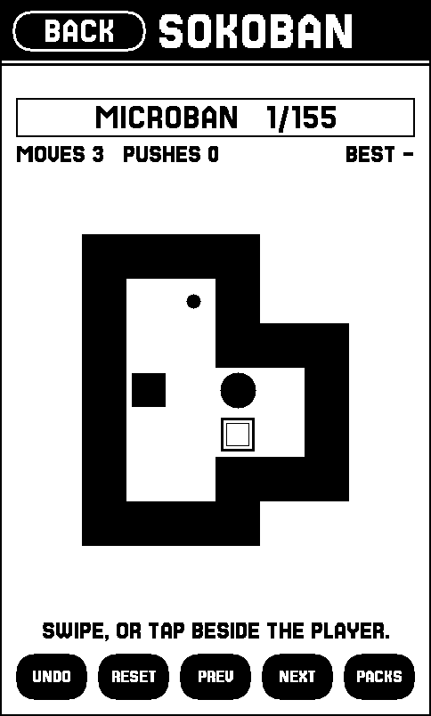

# Sokoban

Push every box onto a goal. There are 385 levels in five packs, from small warm-ups to large boards with dozens of boxes.

## Screenshot

Drawn on a PC by `tools/preview/screenshots.sh`, with the same pixels the panel shows.

## Rules

- The player (the black disc) moves one square at a time, left, right, up or down.
- Walking into a box pushes it one square, if the square behind it is free. A wall or a second box stops the push.
- Boxes can only be pushed, never pulled.
- The level is solved when every box sits on a goal (the small dots). A box on a goal turns solid black.

## Packs

| Pack | Levels | By |
|---|---|---|
| `MICROBAN` | 155 | David W. Skinner: small boards, a good place to start |
| `SASQUATCH` | 50 | David W. Skinner: hard, with the largest boards |
| `LOMA` | 100 | Aymeric du Peloux and others |
| `MICROCOSMOS` | 40 | Aymeric du Peloux |
| `MINICOSMOS` | 40 | Aymeric du Peloux |

## Getting around

- **Moving:** swipe in the direction to go, or tap the board on the side of the player you want to go (whichever way the tap is further). The Up and Down buttons step up and down too.
- The capsule shows the pack and level, such as `MICROBAN   12/155`, and the line under it your moves, pushes and best for the level.
- `UNDO` takes back your last move, with its push, as far back as the start.
- `RESET` asks `RESTART THIS LEVEL?` first; `YES` starts it again and `NO` carries on.
- `PREV` and `NEXT` go to other levels in the pack, wrapping at the ends.
- `PACKS` lists the packs with how many of each you've solved. Tap one to play it, at the level you were on there. `BACK` returns to the level.
- Once solved, the capsule turns black and says `SOLVED`. `NEXT`, or the Down button, goes on to the next level.
- `BACK` in the header returns to the home page. The level is kept, moves and all, so you can finish it later.

## Saves

All in `/.pocketplay/`:

| Name | Holds |
|---|---|
| `sokoban` | The pack you're in, your level in every pack, and every move on the board. Written on every move, so sleep or a flat battery brings back the same position, with undo. |
| `sokoban-best` | The fewest moves you've solved each level in. |

## Credits

Translated from Omer Faruk Inel's Sokoban in touch-licorice-apps and modified for PocketPlay, under the MIT licence (`LICENSE-licorice.txt`). Microban and Sasquatch are by David W. Skinner; LOMA, Microcosmos and Minicosmos are by Aymeric du Peloux (LOMA with levels by others), published on sokobano.de with the authors' permission.
