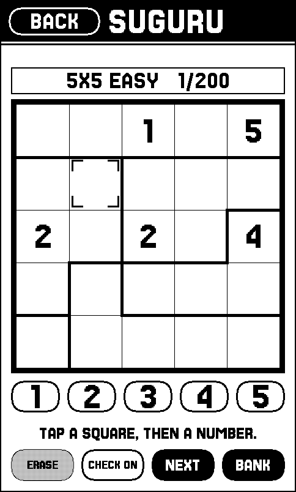

# Suguru

A number puzzle on a grid split into outlined regions, also called Tectonic. There are 800 puzzles in four banks, from 5x5 to 8x8, and each one has a single answer you can reach by logic, without guessing.

## Screenshot

Drawn on a PC by `tools/preview/screenshots.sh`, with the same pixels the panel shows.

## Rules

- A region of n squares holds the numbers 1 to n, each once. A region of one square holds a 1, and a region of five holds 1 to 5.
- Two squares that touch, including diagonally, never hold the same number.
- The numbers already on the board (the givens) can't be changed.
- The puzzle is solved when every square is filled and no rule is broken.

**Banks:**

| Bank | Grid | Puzzles |
|---|---|---|
| `5X5 EASY` | 5 x 5 | 200 |
| `6X6 MEDIUM` | 6 x 6 | 200 |
| `7X7 HARD` | 7 x 7 | 200 |
| `8X8 EXPERT` | 8 x 8 | 200 |

Each bank runs from its easiest puzzle to its hardest.

## Getting around

- Tap a square to choose it, then tap a number from 1 to 5. Corner brackets mark the square you chose. The numbers dim while nothing can go in it: nothing is chosen, it's a given, or the puzzle is solved.
- Your own numbers are underlined, and givens aren't.
- `ERASE` clears the chosen square.
- `CHECK ON` turns any number that breaks a rule black, along with the number it clashes with. Tap it for `CHECK OFF` to play without help.
- `NEXT`, or the Down button, goes to the next puzzle in the bank, and the Up button to the one before. Both wrap round at the ends of the bank.
- `BANK` moves to the next bank, at the puzzle you were on there. A grid you'd half filled in another bank starts again empty.
- The capsule under the header shows the bank and puzzle, such as `6X6 MEDIUM   12/200`. It turns black and says `SOLVED` once you finish, and `NEXT` gives you the next puzzle.
- `BACK` in the header returns to the home page. The puzzle is kept, so you can finish it later.

## Saves

`suguru` in `/.pocketplay/` holds the bank you're in, your place in every bank, whether check is on, and the numbers on the board. It's written on every change, so sleep or a flat battery brings back the same grid. It isn't erased when you solve a puzzle, because it's also your place in the banks.

## Credits

Translated from Omer Faruk Inel's Suguru in touch-licorice-apps, with its puzzles copied unchanged, and modified for PocketPlay, under the MIT licence (`LICENSE-licorice.txt`).
