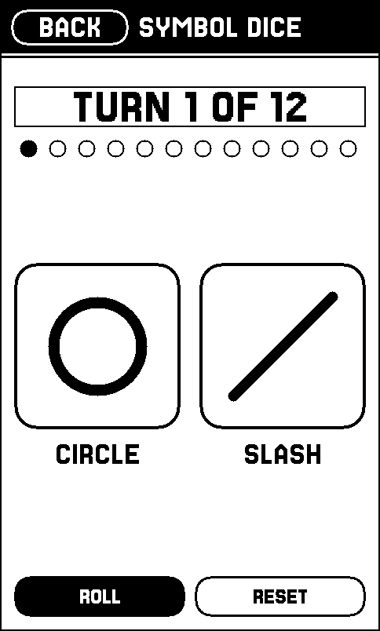

# Symbol Dice

Two dice for a roll-and-write game played on paper, where each turn everyone draws the two rolled symbols on their own sheet. PocketPlay rolls the dice and counts the turns; the sheets and the scoring stay on paper.

## Screenshot

Drawn on a PC by `tools/preview/screenshots.sh`, with the same pixels the panel shows.

## The dice

Each die has six symbols: **triangle**, **cross** (drawn as an X), **circle**, **hash**, **three lines** and **slash**. Every roll throws both dice together, at random, so any of the 36 pairs can come up.

## Playing

- `ROLL`, or the Down button, rolls both dice. Each roll is one turn.
- A game is 12 turns. The capsule at the top says `TURN 3 OF 12`, and the row of dots under it fills in a dot a turn.
- After the 12th roll the capsule turns black and says `GAME OVER: 12 TURNS`, and `ROLL` dims. The last roll stays on screen.
- `RESET` starts a new game straight away, back at turn 0 with blank dice.
- `BACK` in the header returns to the home page. The game is kept.

## Saves

`symboldice` in `/.pocketplay/` holds the turn and the two dice showing. It's written on every roll, so sleep or a flat battery brings back the same turn, and it's erased by `RESET`.

## Credits

Made for playing Reiner Knizia's [Criss Cross](https://boardgamegeek.com/boardgame/220988/criss-cross).
