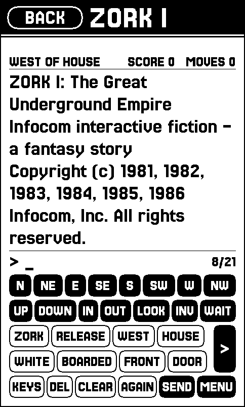

# Text Adventures

Classic interactive fiction: you read where you are, type what to do, and the game replies. It plays Z-machine story files, the format of Infocom's games and of most games written in Inform. Typing is rarely needed, because the common commands are buttons and the game's own words are chips you can tap.

## Screenshot

Drawn on a PC by `tools/preview/screenshots.sh`, with the same pixels the panel shows.

## Games

- **Zork I, II and III are built in.** Microsoft released all three under the MIT licence in 2025.
- **More games:** copy story files (`.z3`, `.z5`, `.z8`, and also `.z4` and `.z7`) into the `textadv` folder at the top of the SD card. The folder is made the first time you open the game. Version 6 games (`.z6`, with pictures) and Glulx games (`.ulx`, `.gblorb`) don't run, and don't appear in the list.
- A `Zork I.z3` on the card takes the built-in copy's place, keeping the same progress.
- Free games are on the [IF Archive](https://ifarchive.org/indexes/if-archive/games/zcode/) and [IFDB](https://ifdb.org). Each game has its own terms.

## Playing

- **The library** lists the games, with `IN PROGRESS` beside any you've started. The last game you played opens straight away.
- **The status line** under the header shows where you are, with the score and moves (or the game's own top line).
- **The transcript:** each reply opens at its beginning. Tap the left third of the text, or press Up, to page back. Tap the rest, or press Down, to page on.
- **Directions:** `N`, `NE`, `E`, `SE`, `S`, `SW`, `W`, `NW`, then `UP`, `DOWN`, `IN` and `OUT`. `LOOK`, `INV` (inventory) and `WAIT` play at once too.
- **Word chips:** the words of the last reply that the game knows, then common verbs (`TAKE`, `DROP`, `EXAMINE`, `OPEN`...). Tapping them builds the command shown above (`> open mailbox`), and `>` shows more chips. `SEND` plays it.
- **Keys:** `KEYS` opens the keyboard with the command so far, `DEL` takes away the last word, `CLEAR` all of them, and `AGAIN` repeats the last command.
- **`MENU`:** the text size (`LARGE` or `SMALL`, for more lines a page), `RESTART`, and `GAMES` to go back to the library.
- `BACK` in the header goes to the library, and from there to the home page.
- A long turn shows `THINKING...` while the game works.

## Saves

All in `/.pocketplay/`, named after a number made from the story's file name:

| Name | Holds |
|---|---|
| `textadv-<number>` | The game, saved after every turn, so leaving, sleep or a flat battery brings you back to the same place. Cleared when the game ends or you restart it. |
| `textadv-<number>-t` | The last 60 lines of the transcript, so you see where you were. |
| `textadv-<number>-s` | The game's own `SAVE`: one more slot a game, which `RESTORE` brings back. |
| `textadv` | The text size and the last game played. |

## Credits

Translated from Omer Faruk Inel's Text adventures in touch-licorice-apps and modified for PocketPlay, under the MIT licence (`LICENSE-licorice.txt`). Zork I, II and III are © Microsoft, released under the MIT licence (`LICENSE-Zork.txt`).
