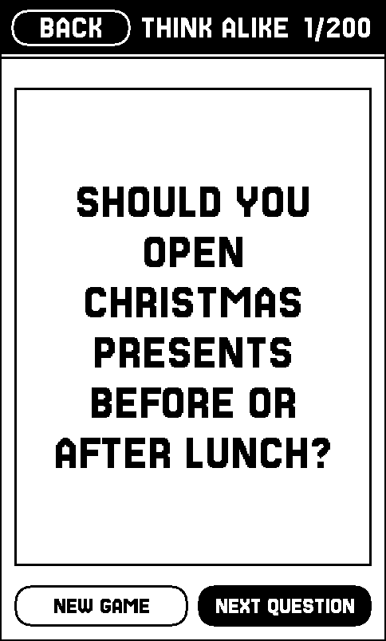

# Think Alike

A question deck for a party game played round a table, where the aim is to think like everyone else. PocketPlay only shows the questions. Answers and points stay on paper.

## Screenshot

Drawn on a PC by `tools/preview/screenshots.sh`, with the same pixels the panel shows.

## Rules

- Read the question out loud.
- Everyone writes an answer in secret, then everyone shows or says theirs at once.
- Everyone who gave the most common answer scores a point. If two answers tie for most common, nobody scores.
- Agree on a winning score before you start, such as 8 points.

## Getting around

- `NEXT QUESTION`, or the Down button, shows a question that hasn't come up since the last shuffle. The band shows how far through you are, such as `3/5`.
- After the last question, the band shows `5/5` (or however many you have), `NEXT QUESTION` dims, and `NEW GAME` shuffles them all again.
- `NEW GAME` shuffles every question and shows the first one.
- `BACK` returns to the home page and keeps your place.

## Your questions

The questions come from a text file on the SD card: `/thinkalike/questions.txt`. A starter file of questions is in this folder as [questions.txt](questions.txt). Copy it to the card, then add your own on any computer.

- One question per line, up to 1000 questions of up to 200 characters each.
- Blank lines, and lines starting with `#`, are skipped.
- Questions are shown in capitals, however you type them.
- Curly quotes and dashes from a word processor are turned into plain ones. Other letters outside plain English, such as `é`, are left out, because the font can't draw them.

The game reads the file each time it opens. If the file has changed since the last shuffle, it shuffles the new questions. If the card has no file, the game makes the `/thinkalike` folder and says what to copy into it.

## Saves

All in `/.pocketplay/`:

| Name | Holds |
|---|---|
| `thinkalike` | The shuffle, how many questions have been shown, and a checksum of the question file. It's written on every `NEXT QUESTION` and `NEW GAME`, so after a sleep or a flat battery you get the same question back. |

The icon is Lucide's messages-square (ISC licence). Plays like the party game Herd Mentality, with its own name and questions. Thanks to Herd Mentality's designers, Rich Coombes and Dan Penn, for the game it's played after: [Herd Mentality](https://boardgamegeek.com/boardgame/311322/herd-mentality).
