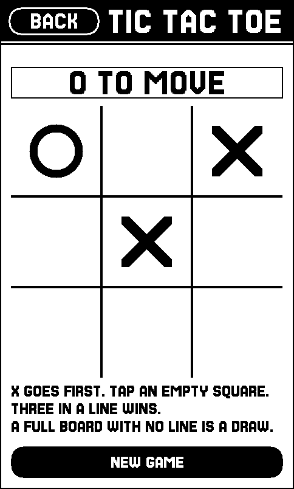

# Tic Tac Toe

Two players share one device and take turns on a 3x3 grid.

## Screenshot

Drawn on a PC by `tools/preview/screenshots.sh`, with the same pixels the panel shows.

## Rules

- X always moves first, then the players take turns.
- Tap an empty square to put your mark there.
- The first player to get three marks in a row (across, down or diagonally) wins.
- If all nine squares fill up and nobody has three in a row, the game is a draw.

## Getting around

- The line above the grid says whose turn it is (`X TO MOVE`), or how the game ended (`X WINS`, `O WINS`, `A DRAW`).
- `NEW GAME` under the grid clears the board and starts again.
- `BACK` in the header returns to the home page. The game is kept, so you can finish it later.

## Saves

`tictactoe` holds the board and whose turn it is. It's written after every move, so sleep or a flat battery brings you back to the same board, and it's erased when the game ends or you tap `NEW GAME`.

## Credits

Copied from CrossPlay and modified for PocketPlay, under the MIT licence (`LICENSE-CrossPlay.txt`). The icon is from Lucide (ISC licence).
