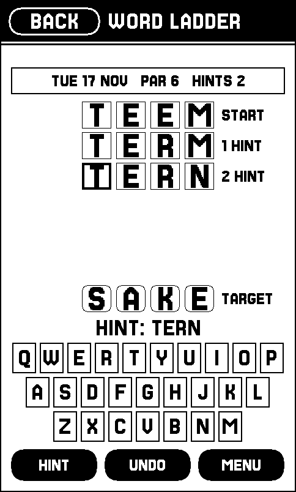

# Word Ladder

Lewis Carroll's doublets, a new one every day: change the start word into the target one letter at a time, and every step must be a word. COLD, CORD, CARD, WARD, WARM.

## Screenshot

Drawn on a PC by `tools/preview/screenshots.sh`, with the same pixels the panel shows.

## Rules

- Change one letter at a time. Each new word must be in the word list, and no word can be used twice.
- The ladder is solved when the newest word is the target.
- **Par** is the length of the shortest ladder. Fewer steps than par is impossible; more is fine.

## Puzzles

There are 730 ladders. Day 1 is 1 November 2026, and after the last one the list starts over. Most have four letters, and every third day has five. Each shortest ladder is 4 to 6 steps.

Until the clock has been set over Wi-Fi, 1 November 2026 counts as today.

## Getting around

- Tap a letter of the newest word to frame it, or move the frame with the Up and Down buttons. Then tap its new letter on the keys.
- If the result is a word, it joins the ladder. If not, the line under the ladder says why, such as `QLEE IS NOT IN THE WORD LIST.`
- Letters already where the target has them are underlined.
- `UNDO` takes back the last step, all the way to the start.
- `HINT` adds the next word of a shortest ladder from where you are, even if you've left the usual one. A step from a hint is labelled `HINT`, and the capsule counts them.
- When there are more steps than fit, the newest are shown and a row counts the rest.
- Once solved, the capsule turns black and shows your steps beside par.
- `MENU` shows the day's ladder number and your record. It also has:
  - `TODAY`
  - `EARLIER` and `LATER`, to step between days. Each day keeps its own ladder, and `LATER` stops at today.
  - `START OVER`
  - `ANSWER`, which shows a shortest ladder
  - `HOW TO PLAY`
- `BACK` returns to the board from a menu page, or to the home page from the board.

## Saves

All in `/.pocketplay/`:

| Name | Holds |
|---|---|
| `wordladder` | The ladder of every day you've played, up to the newest 400 days, with which steps came from hints. Written on every step, so sleep or a flat battery brings back the same ladder. |

## Credits

Translated from Omer Faruk Inel's Word Ladder in touch-licorice-apps, and modified for PocketPlay, under the MIT licence (`LICENSE-licorice.txt`). The puzzles and word lists are copied unchanged. They were built from Alan Beale's 12dicts (public domain), whose inflected forms come from Kevin Atkinson's AGID (`LICENSE-12dicts.txt`).
